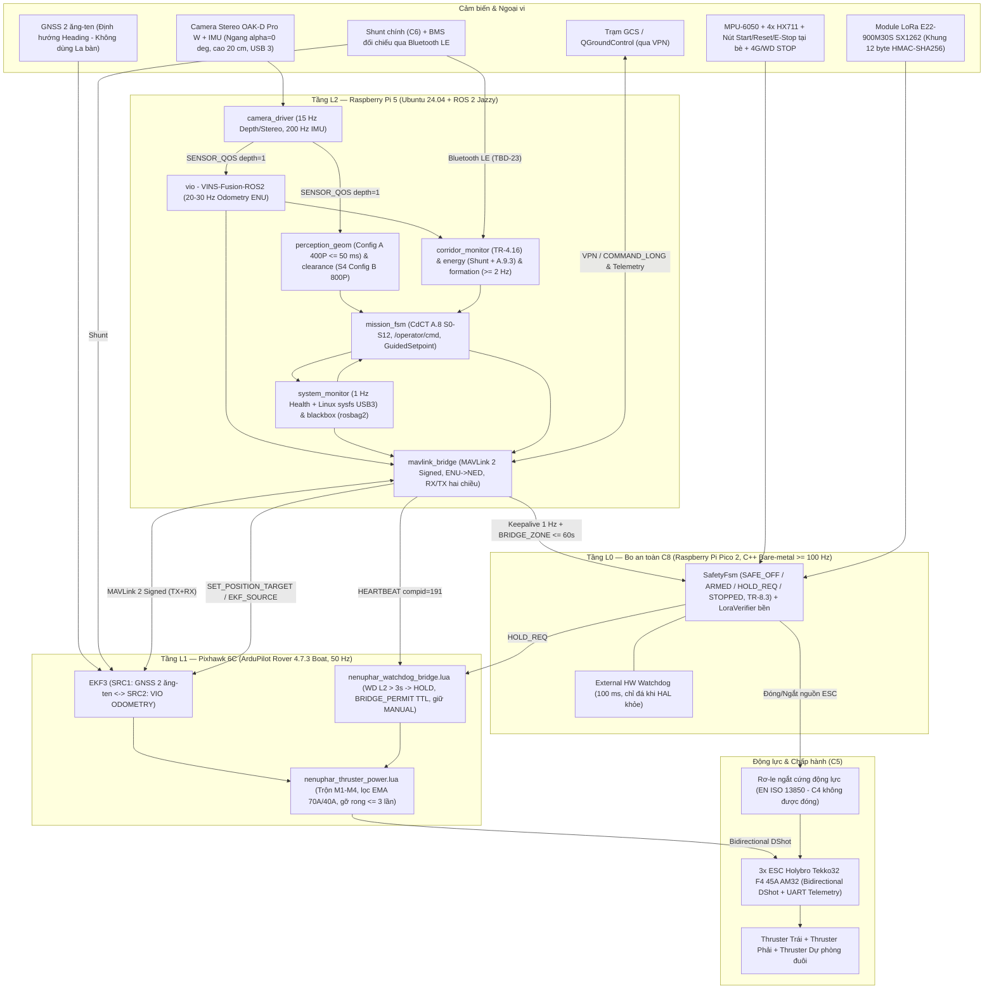
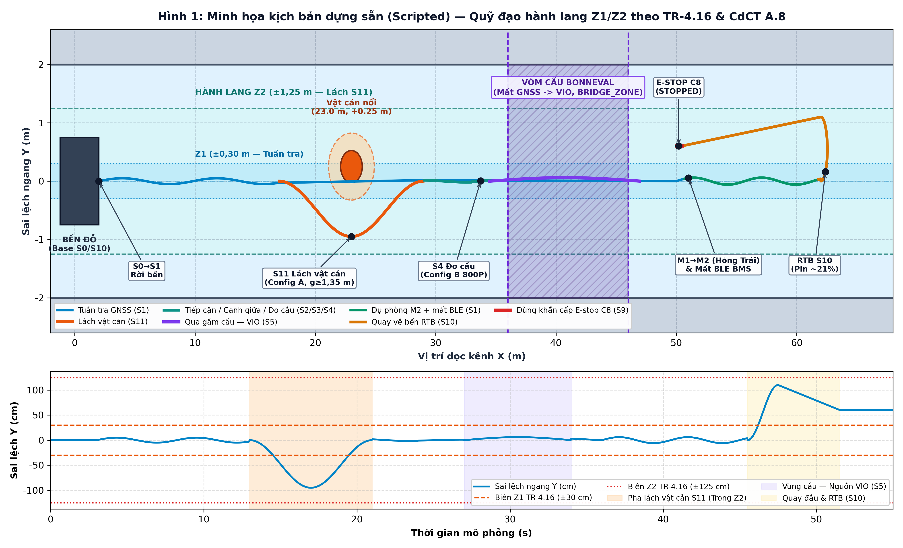
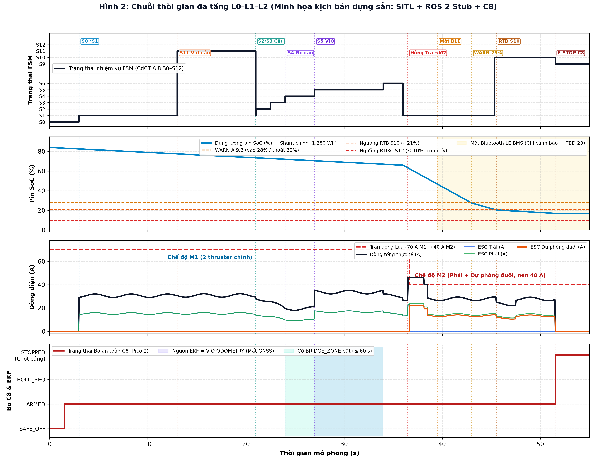
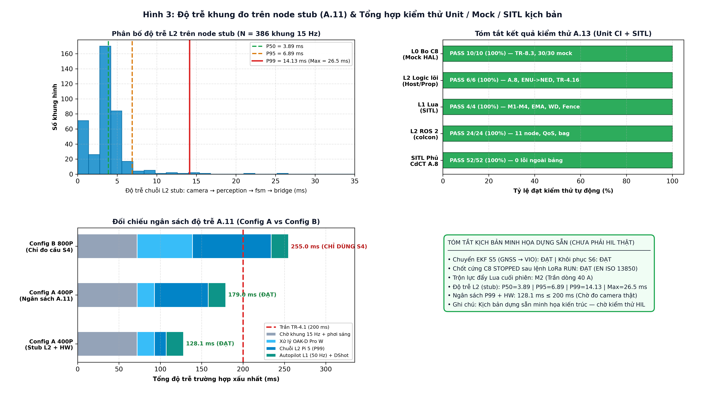

# NÉNUPHARES BONNEVAL — Phần mềm Bè Tự Hành (`nenuphares-sw`)

Kho mã nguồn điều khiển, nhận thức và an toàn 3 tầng cho hệ thống bè tự hành **NÉNUPHARES BONNEVAL**, phát triển bám sát tài liệu đặc tả **CdCT Final 2.0 (20/11/2026)**, nguồn chân lý máy đọc [docs/cdct_spec_a8_a10.yaml](docs/cdct_spec_a8_a10.yaml) và tập luật cứng tại [PROJECT_RULES.md](PROJECT_RULES.md).

> **Tài liệu kỹ thuật chuyên sâu (Sơ đồ khối & Logic chi tiết toàn hệ thống):**
> Xem tại **[docs/SYSTEM_ARCHITECTURE_AND_LOGIC.md](docs/SYSTEM_ARCHITECTURE_AND_LOGIC.md)** để theo dõi đầy đủ luồng dữ liệu 11 node ROS 2, bảng chuyển trạng thái chuẩn CdCT A.8 `S0–S12` (52 nhánh), cơ chế 3 tầng lỗi, chuỗi qua gầm cầu, logic Lua tầng L1 và mạch an toàn cứng L0 C8.

---

## 1. Phạm vi hệ thống (V1 vs V2)

| Hạng mục | V1 (Mục tiêu hiện tại tại Việt Nam) | V2 (Triển khai thực tế tại Bonneval, Pháp) |
| :--- | :--- | :--- |
| **Quy mô** | 1 bè mẫu kiểm thử tích hợp các tầng L0–L2 | 40 bè (lô thí điểm 3–5 bè ở L3 trước cổng G-V2) |
| **Trạm điều khiển** | QGroundControl trên laptop (qua VPN) | Web HMI trung tâm (Phụ lục B) |
| **Cảm biến & Cơ cấu** | Không neo, không UWB, không phân đoạn B6A | Có neo, tùy chọn UWB bè-tới-bè, bật B6A (`YOLOv8n-seg`) |
| **Đội hình (`formation`)** | Khung giao diện tối thiểu (`ROLE_SINGLE_V1`, `s_ref >= 2 Hz`) | Đầy đủ Leader/Deputy `s_ref(t) >= 2 Hz` + đồng bộ GNSS |
| **Băng tần LoRa (D-27)** | `920–923 MHz` (QCVN 122:2020/BTTTT) | `869,4–869,65 MHz` (chu kỳ phát `<= 10%`) |

---

## 2. Sơ đồ khối tổng quan 3 tầng

Hệ thống áp dụng kiến trúc **bảo vệ theo chiều sâu (Defense in Depth)** gồm 3 tầng tính toán tách biệt. Nếu tầng cao (L2) treo, tầng dưới (L1) tự đưa bè về trạng thái giữ vị trí `HOLD`; nếu cả L2 và L1 gặp sự cố hoặc nhận lệnh dừng khẩn cấp, bo an toàn độc lập L0 sẽ cắt cứng nguồn rơ-le động lực.



---

## 3. Tóm tắt ngăn xếp công nghệ & phân tầng

| Tầng | Phần cứng mục tiêu | Ngôn ngữ & Nền tảng | Trách nhiệm chính | Thư mục mã nguồn |
| :---: | :--- | :--- | :--- | :--- |
| **L2** | Raspberry Pi 5 (Ubuntu 24.04) | **Python** & **C++** (ROS 2 Jazzy) | Nhận thức OAK-D Pro W, chuyển trục ENU→NED cho VIO, FSM chuẩn CdCT A.8 `S0–S12`, giám sát hành lang TR-4.16, năng lượng shunt/BLE A.9.3, hộp đen `rosbag2`, cầu MAVLink 2 ký số hai chiều | [l2_ros2_ws](l2_ros2_ws) |
| **L1** | Pixhawk 6C | **Lua** + Tham số ArduPilot (`Rover-4.7.3`) | Khung thuyền `FRAME_CLASS=2` (`50 Hz`), định hướng GNSS 2 ăng-ten, `BATT_FS_*`/`FENCE_*`, trộn lực đẩy `M1–M4` có lọc EMA + gỡ rong `<= 3` chu kỳ, watchdog Pi 5 `3 s` + `BRIDGE_PERMIT` TTL | [l1_ardupilot](l1_ardupilot) |
| **L0** | Bo C8 (Raspberry Pi Pico 2) | **C++** bare-metal (`core/` + `hal/` + `firmware/`) | Ngắt cứng rơ-le động lực chuẩn EN ISO 13850 (`Start` & `Reset` bắt sườn tại bè, C4 không đóng relay), ngưỡng nghiêng/tải TR-8.3 + fail-safe cảm biến, LoRa 12B HMAC bền vững qua reboot | [l0_c8_pico2](l0_c8_pico2) |

### Quy tắc kiến trúc bất biến (CdCT Final 2.0)

1. **Không LiDAR, không nghiêng camera:** chỉ dùng stereo **OAK-D Pro W + IMU** lắp ngang (`alpha_tilt = 0°`), cao `20 cm` trên boong.
2. **Không dùng la bàn từ:** hướng mũi lấy từ **GNSS 2 ăng-ten** (`COMPASS_USE=0`, `EK3_SRC1_YAW=2`).
3. **Chốt duy nhất 1 gói VIO:** `VINS-Fusion-ROS2` (Jazzy), loại bỏ nhánh nghiên cứu ghép chặt TBD-28.
4. **Đo nguồn bằng Shunt + đối chiếu BLE BMS + 3 ESC:** không dùng BMS UART/CAN hay cảm biến dòng ACS; mất Bluetooth LE chỉ cảnh báo, tuyệt đối không dừng bè (TBD-23).
5. **FSM chuẩn CdCT A.8 (`S0–S12`) đọc từ `cdct_spec_a8_a10.yaml`:** thứ tự ưu tiên cứng `S9 > S8 > S12 > S7 > S11 > S10 > S1` (`S2` tiếp cận cầu, `S3` canh giữa, `S7` chờ/hold, `S8` rời cầu khẩn, `S11` lách vật cản).
6. **Không hardcode kích thước thân bè (TBD-06):** nạp động từ [config/raft_profiles/v1_70x50.yaml](config/raft_profiles/v1_70x50.yaml) hoặc [config/raft_profiles/v1_98x68.yaml](config/raft_profiles/v1_98x68.yaml).

---

## 4. Hiện trạng kiểm chứng & Dữ liệu mô phỏng V1

> **Ghi chú trung thực về phạm vi kiểm chứng:**
> - Các bài kiểm thử C++ (`l0_c8_pico2`), Python logic (`test_core_logic_host.py`) và ROS 2 (`colcon test`) hiện xác minh **lõi thuật toán, nối dây topic và Mock HAL/sysfs**. Driver phần cứng RP2350 (MPU-6050/HX711/SX1262), `depthai-ros` với camera OAK-D Pro W thật và thử nghiệm **HIL trên bè thật chưa thực hiện**.
> - Các hình ảnh và video trong [demo_output](demo_output) được sinh từ [scripts/run_demo_scenario.py](scripts/run_demo_scenario.py) theo **quỹ đạo, đường SoC và sự kiện lập lịch sẵn để minh họa ý tưởng**, **không phải** số liệu đo vòng kín thực nghiệm.

| Hạng mục kiểm thử | Phạm vi thực tế | Trạng thái |
| :--- | :--- | :--- |
| **L0 Bo C8 (`ctest`)** | `10/10` GTest trên `MockC8Hal` (bắt sườn start/reset, TR-8.3, cảm biến `NaN`/trễ, lưu counter qua reboot, 4G/WD STOP, `30/30` E-stop) | PASS (Mock HAL; firmware Pico 2 đang ở dạng khung) |
| **L2 Logic lõi (`test_core_logic_host.py`)** | `6/6` test thuần Python (property Tầng 3 trên cả `13` trạng thái `S0..S12`, ENU→NED, hành lang TR-4.16, hysteresis A.9.3, tĩnh không S4, sysfs USB 3) | PASS (Host Unit + Property) |
| **L1 Lua & Failsafe (`test_l1_sitl_failsafes.py`)** | SITL ArduPilot Rover Boat sống (`M1–M4`, nén dòng `70/40 A`, WD `3 s`, giữ quyền `MANUAL`, `BATT_FS_*`, `FENCE_*`, `EKF source 2`) | PASS (SITL kịch bản) |
| **L2 ROS 2 (`colcon test`)** | `24/24` PASS (`11` node, `SENSOR_QOS`, heartbeat + keepalive C8, `/operator/cmd`, `rosbag2`) | PASS trên ROS 2 Jazzy |
| **Độ phủ A.8 (`test_sitl_fsm_a8_coverage.py`)** | `52/52` cạnh hợp lệ theo `cdct_spec_a8_a10.yaml`, `0` cạnh ngoài bảng | PASS (SITL kịch bản) |
| **Số liệu độ trễ demo minh họa** | Trên node stub (`demo_summary.json`): `L2 P99 = 14,13 ms`, `L2 Max = 26,52 ms` (tổng P99 + HW `128,13 ms`, tổng Max + HW `140,52 ms`); chưa có camera/nhận thức thật | Minh họa khung đo; **chờ HIL camera thật** |







---

## 5. Cấu trúc kho mã nguồn

```text
nenuphares-sw/
├── README.md                          # Tổng quan, sơ đồ khối & hướng dẫn nhanh
├── PROJECT_RULES.md                   # Tập luật cứng CdCT Final 2.0
├── VERSIONS.md                        # Phiên bản OS, ROS 2 Jazzy, ArduPilot, VINS-Fusion-ROS2
├── .github/workflows/ci.yml           # Pipeline CI (YAML + Host logic test, L0 GTest, L2 colcon test)
├── config/
│   ├── raft_profiles/
│   │   ├── v1_70x50.yaml              # Thân cơ sở 70 x 50 x 25 cm (TBD-06)
│   │   └── v1_98x68.yaml              # Thân dự phòng mở rộng 98 x 68 x 25 cm
│   ├── energy_A9.yaml                 # Ngưỡng pin 1.280 Wh (hysteresis 28%/30%, RTB 21%, <=10%->S12)
│   └── corridor_D16.yaml              # Hành lang TR-4.16 (Z1 0.30m/5s, Z2 1.25m, g>=1.35m), S4, TR-4.1
├── docs/
│   ├── cdct_spec_a8_a10.yaml          # Nguồn chân lý máy đọc (A.8 52 cạnh, TR-4.16, A.9.3, TR-8.3)
│   ├── SYSTEM_ARCHITECTURE_AND_LOGIC.md # Tài liệu chi tiết kiến trúc, sơ đồ khối & logic L2/L1/L0
│   ├── INTERFACE_FREEZE_A14.md        # Đóng băng giao diện ROS 2, MAVLink 2, C8 & LoRa 12B
│   ├── SPEC_PHU_LUC_A.md              # Đặc tả kỹ thuật Phụ lục A
│   ├── VIO_FEASIBILITY_B.md           # Khả thi & bản vá VINS-Fusion-ROS2 trên Jazzy
│   ├── tr_fr_traceability_matrix.md   # Ma trận truy vết yêu cầu TR/FR - kiểm thử (trung thực)
│   ├── tbd20_tuning_tracker.csv       # Theo dõi tham số tinh chỉnh TBD-20
│   └── hil_poweron_checklist.md       # Checklist cấp nguồn & kiểm thử HIL
├── l0_c8_pico2/                       # C++ bare-metal Bo C8 (core/, hal/, firmware/ Pico 2, tests/)
├── l1_ardupilot/                      # Tham số SITL A.7, Lua M1-M4/EMA/unjam/Watchdog TTL & test SITL
├── l2_ros2_ws/                        # ROS 2 Jazzy workspace (nenuphar_msgs, 11 nodes, sim_tests)
├── scripts/                           # Script chạy demo minh họa & xuất hình/video
├── tools/                             # Công cụ phân tích rosbag2 hộp đen
└── demo_output/                       # Biểu đồ, log và video minh họa kịch bản dựng sẵn
```

---

## 6. Hướng dẫn Build & Kiểm thử nhanh

### 6.1 Kiểm tra file YAML & Unit/Property test lõi L2 (không cần ROS runtime)

```bash
python3 -c "import yaml, glob; files = sorted(glob.glob('config/**/*.yaml', recursive=True)) + ['docs/cdct_spec_a8_a10.yaml']; assert files; [yaml.safe_load(open(f)) for f in files]; print('Validated:', files)"
PYTHONPATH=l2_ros2_ws/src/nenuphar_nodes pytest -v l2_ros2_ws/src/nenuphar_nodes/test/test_core_logic_host.py
```

### 6.2 Build và chạy Unit Test tầng L0 (Bo an toàn C8 — GoogleTest / CTest)

```bash
cmake -S l0_c8_pico2 -B l0_c8_pico2/build
cmake --build l0_c8_pico2/build -j2
ctest --test-dir l0_c8_pico2/build --output-on-failure
```

*(Tùy chọn build firmware RP2350 khi đã cài `pico-sdk`: `cmake -S l0_c8_pico2 -B l0_c8_pico2/build_pico -DC8_BUILD_PICO_FIRMWARE=ON -DPICO_BOARD=pico2`)*

### 6.3 Build và chạy Unit Test tầng L2 (ROS 2 Jazzy)

```bash
source /opt/ros/jazzy/setup.bash
cd l2_ros2_ws
colcon build --symlink-install
source install/setup.bash
colcon test --event-handlers console_direct+
colcon test-result --all --verbose
```

### 6.4 Khởi chạy 11 node L2, đo độ trễ P99/max & phân tích hộp đen

```bash
ros2 launch nenuphar_nodes nenuphar_v1.launch.py enable_stub_stream:=true
ros2 run nenuphar_nodes latency_probe --samples 50 --timeout 15.0
python3 tools/analyze_blackbox_bag.py demo_output/demo_blackbox_bag
```

---

## 7. Bản đồ tài liệu dự án

- [SYSTEM_ARCHITECTURE_AND_LOGIC.md](docs/SYSTEM_ARCHITECTURE_AND_LOGIC.md) — Kiến trúc chi tiết, sơ đồ khối và giải thích toàn bộ logic L2/L1/L0.
- [cdct_spec_a8_a10.yaml](docs/cdct_spec_a8_a10.yaml) — Nguồn chân lý máy đọc cho FSM `S0–S12` và các bảng ngưỡng.
- [PROJECT_RULES.md](PROJECT_RULES.md) — Tập luật cứng phát triển phần mềm CdCT Final 2.0.
- [INTERFACE_FREEZE_A14.md](docs/INTERFACE_FREEZE_A14.md) — Chuẩn topic ROS 2, MAVLink 2, tín hiệu Bo C8 và gói LoRa 12 byte.
- [SPEC_PHU_LUC_A.md](docs/SPEC_PHU_LUC_A.md) — Đặc tả kỹ thuật chi tiết Phụ lục A.
- [tr_fr_traceability_matrix.md](docs/tr_fr_traceability_matrix.md) — Ma trận truy vết yêu cầu kỹ thuật và trạng thái kiểm chứng thực tế.
- [hil_poweron_checklist.md](docs/hil_poweron_checklist.md) — Quy trình kiểm tra cấp nguồn & HIL trên phần cứng thật.
- [VERSIONS.md](VERSIONS.md) — Phiên bản các gói phần mềm đã ghim.
