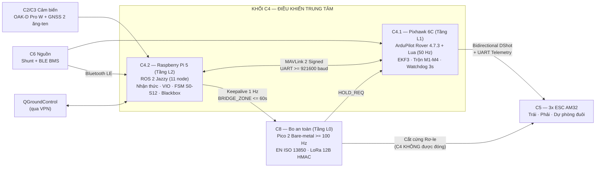
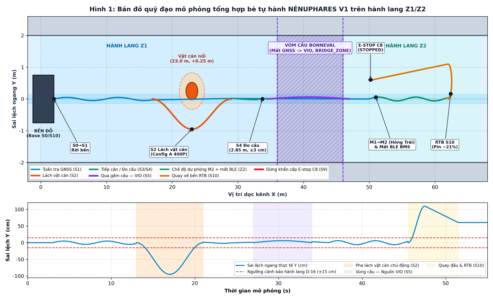
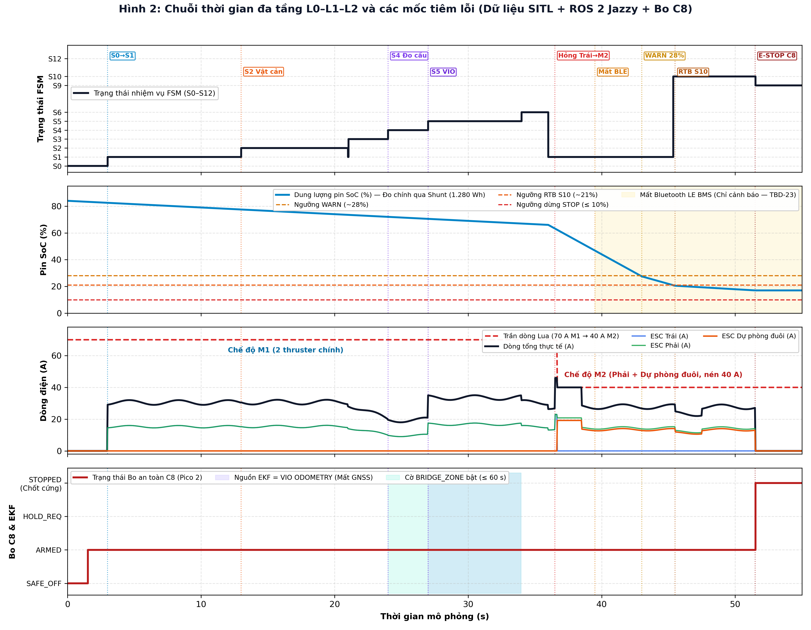
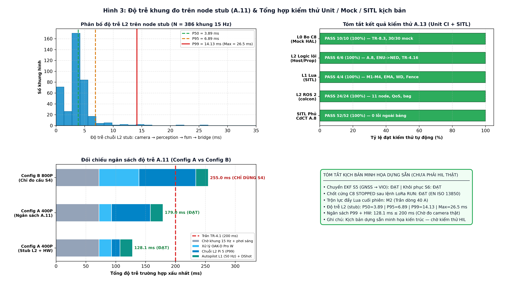

# Tài liệu Trình bày Khối C4 — Điều khiển & Máy tính Nhúng (`nenuphares-sw`)

Tài liệu tóm tắt theo **8 mục trọng tâm** (thời lượng 10–15 phút) cho buổi báo cáo tiến độ **Khối C4** (gồm **C4.1 Pixhawk 6C / Tầng L1** và **C4.2 Raspberry Pi 5 / Tầng L2**) của dự án **NÉNUPHARES BONNEVAL V1 — CdCT Final 2.0**.

> **Tài liệu kỹ thuật chi tiết đi kèm:** [SYSTEM_ARCHITECTURE_AND_LOGIC.md](SYSTEM_ARCHITECTURE_AND_LOGIC.md) · [INTERFACE_FREEZE_A14.md](INTERFACE_FREEZE_A14.md) · [tr_fr_traceability_matrix.md](tr_fr_traceability_matrix.md) · [hil_poweron_checklist.md](hil_poweron_checklist.md)

---

## Mục 1 — Vai trò Khối C4 trong Kiến trúc Bảo vệ 3 tầng

- **Triết lý Bảo vệ theo chiều sâu (Defense in Depth):**
  - **C4.2 (L2)** ra quyết định nhiệm vụ & nhận thức; nếu C4.2 treo, **C4.1 (L1)** tự ép `HOLD` sau `3 s`.
  - **C8 (L0)** độc lập hoàn toàn ở mức phần cứng bare-metal; **C4 tuyệt đối không có quyền đóng contactor động lực**.

---

## Mục 2 — Giao diện Vật lý & Truyền thông của Khối C4

| Kết nối | Bus / Giao thức | Tốc độ / Tần số | Chiều dữ liệu | Cơ chế an toàn / Bảo mật |
| :--- | :--- | :---: | :---: | :--- |
| **OAK-D Pro W → C4.2** | USB 3 SuperSpeed | `>= 5000 Mbps` (15 Hz depth/VIO, 200 Hz IMU) | C3 → C4.2 | Kiểm tra tốc độ thực qua Linux sysfs; rớt USB 2 khóa cứng tại `S0` |
| **C4.2 ↔ C4.1** | UART nội bộ IP67 (MAVLink 2) | `>= 921.600 baud` | Hai chiều | Bật **MAVLink 2 signing** (khóa 32 byte); chuyển chuẩn `ENU/FLU → NED/FRD` |
| **C4.1 → 3× ESC (C5)** | Bidirectional DShot + UART | `50 Hz` lệnh / `5–10 Hz` telemetry | Hai chiều | `30 A/ESC`, PWM `24 kHz`, tự về `0` khi mất tín hiệu |
| **Nguồn C6 → C4.1 / C4.2** | Shunt Analog + Bluetooth LE | `1–2 Hz` shunt / `1 Hz` BLE | C6 → C4 | Shunt là nguồn đo chính; mất BLE chỉ cảnh báo (TBD-23) |
| **C4 ↔ Bo an toàn C8** | GPIO / UART nội bộ | Keepalive `1 Hz`, `BRIDGE_ZONE <= 60 s` | Hai chiều | Mất keepalive `3 s` → `HOLD_REQ`; C4 không có lệnh đóng contactor |
| **C4.2 ↔ QGroundControl** | MAVLink 2 qua VPN | Liên tục | Hai chiều | Lệnh vận hành `START/HOLD/RTB/RESET/ESTOP` → `/operator/cmd` |

---

## Mục 3 — 7 Nguyên tắc Thiết kế cứng (CdCT Final 2.0)

1. **Không LiDAR, không nghiêng camera:** chỉ dùng stereo OAK-D Pro W lắp ngang (`alpha_tilt = 0°`), cao `20 cm` trên boong.
2. **Không dùng la bàn từ:** định hướng bằng **GNSS 2 ăng-ten** (`COMPASS_USE*=0`, `EK3_SRC1_YAW=2`) để tránh nhiễu từ trường từ dòng `70 A` và kết cấu cầu.
3. **Chốt 1 gói VIO duy nhất (`VINS-Fusion-ROS2`):** đã kiểm chứng biên dịch trên Ubuntu 24.04 + Jazzy ([VIO_FEASIBILITY_B.md](VIO_FEASIBILITY_B.md)); loại bỏ Basalt và nhánh TBD-28.
4. **Shunt chính + đối chiếu BLE BMS + 3 ESC:** loại bỏ BMS UART/CAN và cảm biến ACS cũ; mất BLE tuyệt đối không dừng bè.
5. **Nguồn chân lý máy đọc ([cdct_spec_a8_a10.yaml](cdct_spec_a8_a10.yaml)):** toàn bộ 13 trạng thái `S0–S12`, 52 cạnh chuyển hợp lệ và ngưỡng an toàn nạp từ một tệp YAML duy nhất.
6. **Không hardcode kích thước thân bè (TBD-06):** nạp động `v1_70x50.yaml` hoặc `v1_98x68.yaml` (gồm cả `total_height_above_water_m` cho phép đo cầu `S4`).
7. **Bảo mật & Chống tái khởi động bất ngờ:** ký MAVLink 2 (32B), LoRa 12B HMAC-SHA256 kèm `sender_id` và lưu counter qua reboot.

---

## Mục 4 — Kiến trúc bên trong C4.2 (Raspberry Pi 5 — 11 Node ROS 2 Jazzy)

| Nhóm chức năng | Các Node ROS 2 (11 node) | Vai trò cốt lõi, QoS & Lập lịch CPU |
| :--- | :--- | :--- |
| **Nhận thức & Định vị** *(Ưu tiên cao nhất)* | `1. camera_driver` `2. vio` (`VINS-Fusion`) `3. perception_geom` `4. clearance` | Đọc stereo/depth `15 Hz` & IMU `200 Hz`, xuất VIO `20–30 Hz`, phát hiện vật cản Config A 400P (`<= 50 ms`) và đo tĩnh không `S4` Config B 800P. Dùng **`SENSOR_QOS` (`BEST_EFFORT, depth=1`)** cho luồng cảm biến và **`SCHED_FIFO`** cho 3 node chạy liên tục (`camera_driver`, `vio`, `perception_geom`). |
| **Giám sát an toàn & Trạng thái** | `5. corridor_monitor` `6. energy` `7. formation` | Chiếu polyline hành lang `TR-4.16` (`Z1/Z2`); tính SoC từ shunt thật (`/l1/battery_shunt`) có hysteresis `28%/30%` + đối chiếu BLE; xuất tham chiếu đội hình `s_ref >= 2 Hz`. Dùng **`CMD_QOS` (`RELIABLE, depth=10`)**. |
| **Ra quyết định & Cầu nối L1/L0** | `8. mission_fsm` `9. mavlink_bridge` | `mission_fsm` tổng hợp toàn bộ monitor + `/operator/cmd` → quyết định `S0–S12` và phát `GuidedSetpoint` NED. `mavlink_bridge` (**`SCHED_FIFO`**) đổi hệ trục `ENU→NED`, TX/RX MAVLink 2 ký số hai chiều với L1 và gửi Keepalive/`BRIDGE_ZONE` sang C8. |
| **Giám sát hệ thống & Hộp đen** | `10. system_monitor` `11. blackbox` | `system_monitor` gom `/system/node_heartbeat (1 Hz)` của 10 node kế thừa `MonitoredNode` thành bitmask 10-bit (timeout `3 s`) + đọc tốc độ USB 3 thực từ `/sys/bus/usb/devices`. `blackbox` chạy ưu tiên thấp ghi `rosbag2` (`1 Hz` thường, `10 Hz` tại `S4`/lỗi `>= 2`). |

- **Lý do phân tách QoS ([qos.py](../l2_ros2_ws/src/nenuphar_nodes/nenuphar_nodes/qos.py)):** `SENSOR_QOS` (`BEST_EFFORT, depth=1`) luôn lấy khung hình mới nhất để không tích tụ độ trễ; `CMD_QOS` (`RELIABLE, depth=10`) đảm bảo không rơi lệnh FSM, setpoint hay cảnh báo an toàn.
- **Chuỗi giám sát sống còn (Liveness Chain):** 10 node `MonitoredNode` → `system_monitor` → `/system/health` → `mavlink_bridge` phát MAVLink `HEARTBEAT (compid=191)` xuống C4.1 và `KEEPALIVE` sang C8.
- **Tách lõi logic thuần Python để kiểm thử độc lập:** `fsm_engine`, `mavlink_transforms`, `corridor_logic`, `energy_logic`, `clearance_logic`, `usb_probe` (chạy unit/property test tốc độ cao không phụ thuộc `rclpy`).

---

## Mục 5 — Máy trạng thái Nhiệm vụ `S0–S12` (CdCT A.8) & 3 Tầng Lỗi

- **Thứ tự ưu tiên cứng (phân giải tập trung trong `resolve_fsm_state()`, nạp từ [cdct_spec_a8_a10.yaml](cdct_spec_a8_a10.yaml) — 52 cạnh hợp lệ):**
  $$\text{S9} > \text{S8} > \text{S12} > \text{S7} > \text{S11} > \text{S10} > \text{S1}$$

| Trạng thái | Tên định danh | Chức năng & Quy tắc chuẩn CdCT Final A.8 |
| :---: | :--- | :--- |
| **`S0`** | `INIT_PRECHECK` | Khởi tạo & kiểm tra trước chạy: bắt buộc USB 3 `>= 5000 Mbps` và đủ 10 node sống mới cho `START → S1`. |
| **`S1`** | `MISSION_PATROL` | Tuần tra bình thường trong hành lang `Z1 (±0,30 m)`, tối đa `1,5 m/s`, EKF nguồn `1` (GNSS 2 ăng-ten). |
| **`S2 → S3`** | `BRIDGE_APPROACH` & `CENTERING` | Tiếp cận cầu (`>= 10 m`), giảm tốc `<= 2 km/h (0,556 m/s)`, canh giữa hai thành cầu (`±25 cm`, timeout `30 s → S7`). |
| **`S4`** | `BRIDGE_CLEARANCE` | Đo tĩnh không Config B (`800P`), bật `BRIDGE_ZONE`. Chưa đạt `→ S7` chờ đo lại; rời `S4` xóa sạch kết quả đo cũ. |
| **`S5 → S6`** | `BRIDGE_TRANSIT` & `EXIT` | `S5` qua cầu: bắt buộc `bridge_permit` (TTL `15 s`), EKF nguồn `2` (VIO). `S6` thoát cầu khóa lại RTK; quá `30 s → S12/S7`. |
| **`S7`** | `HOLD_WAIT` | Chờ/giữ vị trí: lỗi bậc 1, `HOLD`, vượt `Z2`, quá hạn `S3`, chưa đạt `S4`, hoặc trạng thái kết thúc khi `S10` cập bến. |
| **`S8`** | `BRIDGE_EMERG_EXIT` | **Rời gầm cầu khẩn cấp:** gặp sự cố bậc 3 trong `S5` nhưng **còn lực đẩy** — thoát khỏi gầm cầu trước, không dừng chết dưới cầu. |
| **`S9`** | `EMERGENCY_STOP` | **Dừng khẩn cấp (ưu tiên cao nhất):** mất toàn bộ lực đẩy / E-stop / lỗi bậc 3 ngoài cầu + `HOLD-ALL <= 2 s`. |
| **`S10`** | `RTB_RETURN_TO_BASE` | Về bến khi pin `<= 21%` hoặc lệnh RTB; cập bến an toàn `→ S7`. |
| **`S11`** | `OBSTACLE_AVOID` | Lách vật cản (`g >= 1,35 m`, trong `Z2 ±1,25 m`, `<= 10 s`). **Ưu tiên `S11 > S10`** để bè đang về bến vẫn lách được vật cản. |
| **`S12`** | `DDKC_EMERG_BERTH` | **Điểm dừng khẩn cấp hành lang (lỗi bậc 2):** lệch `Z1 > 5 s` sau `1` lần thử lại, hoặc **`SoC <= 10%` khi còn lực đẩy**. |

---

## Mục 6 — Hai Luồng Nghiệp vụ Trọng tâm: Qua cầu & Tránh vật cản

- **Chuỗi qua gầm cầu phối hợp 3 tầng (`S2 → S3 → S4 → S5 → S6`):**
  - Tại `S4`: đo tĩnh không bằng **Config B (800P)** ở `<= 2 km/h`; chỉ cấp phép khi `clearance >= total_height_above_water + 0,10 m`, sai lệch CSDL cầu `<= 0,05 m`, độ chụm `<= 0,05 m`. Kết quả đo cũ bị xóa ngay khi rời `S4`.
  - Tại `S5`: tự động gửi `MAV_CMD_SET_EKF_SOURCE_SET(2)` chuyển EKF sang VIO `ODOMETRY` (`ENU/FLU → NED/FRD`, bảo toàn `w = 0`), bật `BRIDGE_ZONE` (L1 nới `FS_GCS_TIMEOUT 5 s → 30 s`, L0 ức chế tự cắt nghiêng/tải), và cấp `BRIDGE_PERMIT` có hạn dùng **TTL 15 s**.
- **Hành lang TR-4.16 ([corridor_logic.py](../l2_ros2_ws/src/nenuphar_nodes/nenuphar_nodes/corridor_logic.py)):**
  - Chiếu lên polyline tuyến; phân biệt `Z1 (±0,30 m)` và `Z2 (±1,25 m)` theo bề rộng.
  - Ngoài Z1 khi không lách: đếm `5 s` → tự hiệu chỉnh thử lại `1` lần → thất bại mới vào `S12`. Đang lách `S11` trong Z2 không gây báo động giả; vượt `±1,25 m` lập tức vào `S7 Hold`.
- **Ngân sách độ trễ TR-4.1 (`<= 200 ms`):**
  - **Config A (400P):** `67` (chờ khung 15 Hz) + `5` (phơi sáng) + `21` (OAK-D) + `<= 65` (Pi 5) + `20` (L1 50 Hz) + `1` (DShot) = **`179 ms <= 200 ms`**.
  - **Config B (800P):** `~255 ms` → cấm dùng tránh vật cản, chỉ dùng tĩnh ở `S4 <= 2 km/h`.

---

## Mục 7 — Kiến trúc bên trong C4.1 (Pixhawk 6C — ArduPilot Rover + Lua)

- **Tham số chuẩn A.7 ([sitl_boat_a7.parm](../l1_ardupilot/params/sitl_boat_a7.parm)):**
  - `FRAME_CLASS=2` (Boat), `SCHED_LOOP_RATE=50 Hz`, `COMPASS_USE*=0`, `EK3_SRC1_YAW=2`, `VISO_TYPE=1` (`EK3_SRC2_*=6`).
  - Bật đủ hành động failsafe thật: `FS_ACTION=2` (Hold), `FS_GCS_ENABLE=1`, `BATT_MONITOR=4`, `BATT_FS_LOW_ACT=1` (RTL @ `12,2 V`), `BATT_FS_CRT_ACT=2` (Hold @ `11,5 V`), `FENCE_ENABLE=1` (`FENCE_ACTION=2`).
- **Lua 1 — Trộn lực đẩy & Nén dòng ([nenuphar_thruster_power.lua](../l1_ardupilot/lua/nenuphar_thruster_power.lua), 50 Hz):**
  - 4 chế độ `M1–M4`: `M1` bình thường (`70 A`), `M2`/`M3` hỏng 1 thruster chính dùng dự phòng đuôi (`40 A`), `M4` hỏng cả 2 chính đẩy thẳng thoát cầu bằng thruster đuôi (`<= 30 A/ESC`, không mô-men lái).
  - Lọc thông thấp **EMA (`alpha = 0,25`) + slew-rate bất đối xứng (`-0,12 / +0,03`)** triệt tiêu dao động dòng 25–50 Hz.
  - Phát hiện kẹt ESC qua telemetry + chạy tối đa **`3` xung đảo chiều gỡ rong** (TR-5.6) trước khi chốt lỗi.
- **Lua 2 — Watchdog Pi 5 & Khóa cầu ([nenuphar_watchdog_bridge.lua](../l1_ardupilot/lua/nenuphar_watchdog_bridge.lua), 10 Hz):**
  - Mất `HEARTBEAT (compid=191)` quá `3 s` → ép `HOLD`; giấy phép `BRIDGE_PERMIT` hết hạn sau **TTL `15 s`** nếu L2 chết.
  - **Giữ quyền ưu tiên con người:** không bao giờ ép `HOLD` nếu người vận hành chuyển sang `MANUAL (0)` hoặc `STEERING (3)`.

---

## Mục 8 — Kết quả Kiểm chứng, Minh họa & Lộ trình HIL Trung thực

| Hạng mục kiểm thử | Kết quả hiện tại | Phạm vi xác minh thực tế |
| :--- | :---: | :--- |
| **L2 ROS 2 Jazzy (`colcon test`)** | **`24/24` PASS** | Đủ 11 node, QoS, nối dây `/operator/cmd` & L1 RX, `rosbag2`, property test Tầng 3 trên cả `13` trạng thái |
| **L1 ArduPilot Boat SITL** | **`1/1` PASS** | Failsafe params thật, Lua `M1–M4`, EMA, WD `3 s`, giữ quyền `MANUAL`, EKF switch |
| **Phủ bảng CdCT A.8 (SITL)** | **`52/52` cạnh PASS** | Đủ 100% cạnh hợp lệ trong `cdct_spec_a8_a10.yaml`, `0` lỗi ngoài bảng (kịch bản) |
| **L0 Bo C8 C++ (`ctest` `-Werror`)** | **`10/10` PASS** | `MockC8Hal`: start/reset bắt sườn, TR-8.3, `NaN`/trễ fail-safe, lưu counter LoRa, `30/30` E-stop mock |
| **Độ trễ đo trên node stub** | `P99 = 14,13 ms` · `Max = 26,52 ms` | Xác nhận khung đo `latency_probe` (`128,13 ms` P99 + HW / `140,52 ms` Max + HW); **chờ camera thật** |

> **Ghi chú minh bạch cho Hội đồng:** 3 biểu đồ dưới đây và video [demo_nenuphares_v1.mp4](../demo_output/demo_nenuphares_v1.mp4) là **kịch bản minh họa dựng sẵn** (chạy SITL + ROS 2 stub + lõi C++ C8) để trực quan hóa tương tác đa tầng, **không thay thế** cho kiểm thử vòng kín HIL/thực địa.

- **Các bước tiếp theo khi có phần cứng (HIL — [hil_poweron_checklist.md](hil_poweron_checklist.md)):**
  1. Tích hợp `depthai-ros` với OAK-D Pro W thật → đo `P99` & `Max` nhận thức thực tế trên Pi 5 (`<= 50 ms`).
  2. Chạy `VINS-Fusion-ROS2` vòng kín với Pixhawk 6C & GNSS 2 ăng-ten ngoài trời.
  3. Ghép driver RP2350 (MPU-6050, 4× HX711, SX1262, Flash) vào khung [l0_c8_pico2/firmware](../l0_c8_pico2/firmware/main.cpp) và chạy nghiệm thu **30/30 lần E-stop vật lý**.
