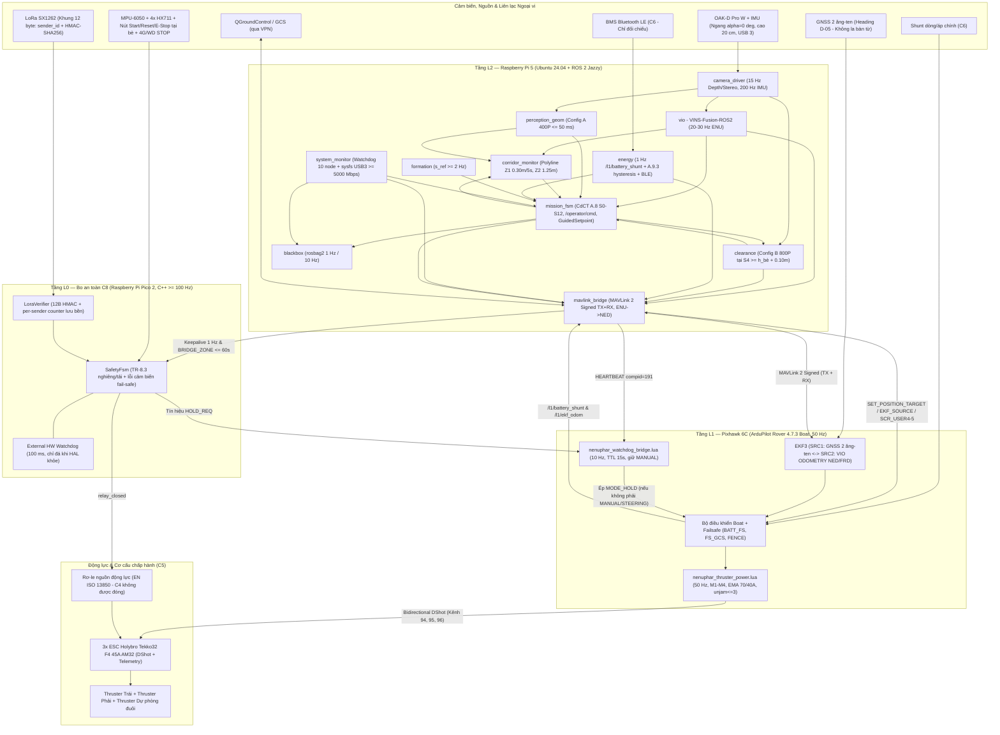
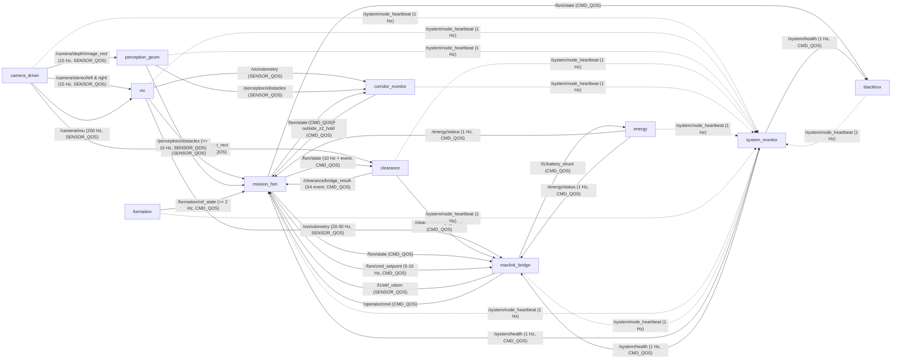
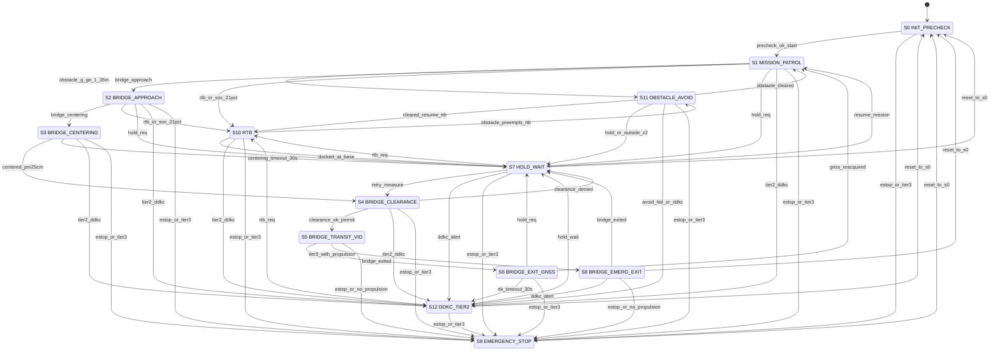
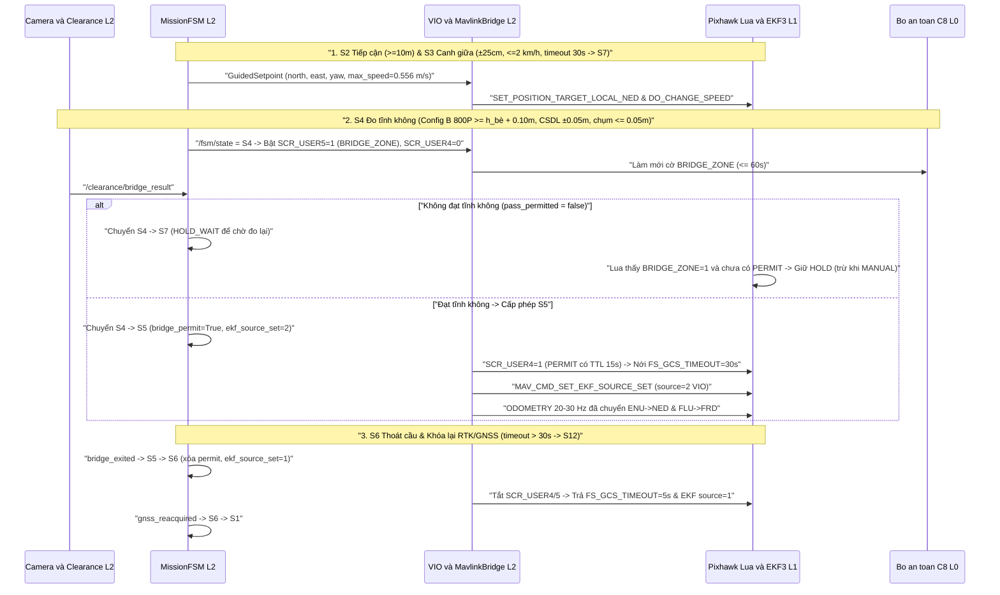

# Kiến trúc Hệ thống & Logic Hoạt động — NÉNUPHARES BONNEVAL (CdCT Final 2.0)

Tài liệu này mô tả đầy đủ **sơ đồ khối kiến trúc**, **luồng dữ liệu thời gian thực**, và **logic xử lý chi tiết** của toàn bộ phần mềm trên 3 tầng (**L2 Raspberry Pi 5**, **L1 Pixhawk 6C**, **L0 Bo an toàn C8**) trong kho mã nguồn `nenuphares-sw`. Mọi trạng thái, bảng chuyển trạng thái và ngưỡng an toàn được trích trực tiếp từ nguồn chân lý máy đọc [cdct_spec_a8_a10.yaml](cdct_spec_a8_a10.yaml) và tập luật cứng tại [PROJECT_RULES.md](../PROJECT_RULES.md).

---

## Phần 1 — Kiến trúc tổng thể 3 tầng & Nguyên lý bảo vệ chiều sâu

Hệ thống phần mềm điều khiển bè tự hành được thiết kế theo nguyên tắc **Bảo vệ theo chiều sâu (Defense in Depth)**: tầng trên xử lý nhận thức phức tạp và lập kế hoạch nhiệm vụ; tầng giữa đảm bảo ổn định điều khiển tàu, trộn lực đẩy chịu lỗi và giữ an toàn hành trình; tầng dưới cùng hoạt động độc lập ở mức phần cứng bare-metal để ngắt động lực tức thời khi có tình huống nguy hiểm.

### Bảng đối chiếu 7 luật cứng Final 2.0 với mã nguồn thực thi

| Luật cứng (`PROJECT_RULES.md`) | Yêu cầu kỹ thuật | Điểm thực thi trong mã nguồn |
| :--- | :--- | :--- |
| **1. Không LiDAR, camera ngang** | Chỉ dùng OAK-D Pro W + IMU, lắp cao `20 cm`, `alpha_tilt_deg = 0.0` | [camera_driver_node.py](../l2_ros2_ws/src/nenuphar_nodes/nenuphar_nodes/camera_driver_node.py) kiểm tra `abs(alpha_tilt_deg) <= 1e-6` |
| **2. Không dùng la bàn từ** | Hướng mũi lấy từ GNSS 2 ăng-ten | [sitl_boat_a7.parm](../l1_ardupilot/params/sitl_boat_a7.parm) đặt `COMPASS_USE*=0`, `EK3_SRC1_YAW=2` |
| **3. Chỉ 1 gói VIO sản phẩm** | Dùng `VINS-Fusion-ROS2` (Jazzy), bỏ TBD-28, chuyển ENU→NED đúng chuẩn | [mavlink_transforms.py](../l2_ros2_ws/src/nenuphar_nodes/nenuphar_nodes/mavlink_transforms.py), [vio_node.py](../l2_ros2_ws/src/nenuphar_nodes/nenuphar_nodes/vio_node.py) (`enable_stub_odom=False` mặc định) |
| **4. Shunt + BLE BMS + 3 ESC** | Không BMS UART/CAN, không cảm biến dòng ACS; mất BLE chỉ cảnh báo | [energy_node.py](../l2_ros2_ws/src/nenuphar_nodes/nenuphar_nodes/energy_node.py), [energy_logic.py](../l2_ros2_ws/src/nenuphar_nodes/nenuphar_nodes/energy_logic.py), [nenuphar_thruster_power.lua](../l1_ardupilot/lua/nenuphar_thruster_power.lua) |
| **5. FSM đầy đủ `S0–S12`** | Đủ 13 trạng thái theo CdCT A.8, ưu tiên `S9 > S8 > S12 > S7 > S11 > S10 > S1` | [fsm_engine.py](../l2_ros2_ws/src/nenuphar_nodes/nenuphar_nodes/fsm_engine.py) |
| **6. Không hardcode hình học** | Đọc kích thước, `total_height_above_water_m`, vị trí cảm biến/thruster từ YAML | [config_loader.py](../l2_ros2_ws/src/nenuphar_nodes/nenuphar_nodes/config_loader.py), [v1_70x50.yaml](../config/raft_profiles/v1_70x50.yaml) |
| **7. Nguồn chân lý máy đọc** | Mọi trạng thái, cạnh chuyển và ngưỡng phải trích từ `docs/cdct_spec_a8_a10.yaml` | [cdct_spec_a8_a10.yaml](cdct_spec_a8_a10.yaml) |

---

## Phần 2 — Sơ đồ khối nội bộ & Luồng dữ liệu 11 Node ROS 2 (Tầng L2)

Tầng L2 gồm **11 node ROS 2 Jazzy** khởi chạy đồng thời qua [nenuphar_v1.launch.py](../l2_ros2_ws/src/nenuphar_nodes/launch/nenuphar_v1.launch.py), tuân thủ chuẩn đóng băng giao diện tại [INTERFACE_FREEZE_A14.md](INTERFACE_FREEZE_A14.md).

### Quy ước QoS ([qos.py](../l2_ros2_ws/src/nenuphar_nodes/nenuphar_nodes/qos.py))

- **`SENSOR_QOS`:** `Reliability = BEST_EFFORT`, `History = KEEP_LAST`, `Depth = 1` (non-blocking).
- **`CMD_QOS`:** `Reliability = RELIABLE`, `History = KEEP_LAST`, `Depth = 10`.

### Chi tiết 11 Node ROS 2 trên Raspberry Pi 5

| STT | Node | Mã nguồn | Đầu vào chính | Đầu ra chính | Lập lịch |
| :---: | :--- | :--- | :--- | :--- | :--- |
| 1 | `camera_driver` | [camera_driver_node.py](../l2_ros2_ws/src/nenuphar_nodes/nenuphar_nodes/camera_driver_node.py) | OAK-D Pro W (hoặc stub 15 Hz) | `/camera/depth/image_rect`, `/camera/stereo/*`, `/camera/imu` | `SCHED_FIFO` |
| 2 | `vio` | [vio_node.py](../l2_ros2_ws/src/nenuphar_nodes/nenuphar_nodes/vio_node.py) | `/camera/stereo/*`, `/camera/imu` | `/vio/odometry` (`enable_stub_odom=False` mặc định) | `SCHED_FIFO` |
| 3 | `perception_geom` | [perception_geom_node.py](../l2_ros2_ws/src/nenuphar_nodes/nenuphar_nodes/perception_geom_node.py) | `/camera/depth/image_rect` | `/perception/obstacles` (`CONFIG_A_400P`) | `SCHED_FIFO` |
| 4 | `clearance` | [clearance_node.py](../l2_ros2_ws/src/nenuphar_nodes/nenuphar_nodes/clearance_node.py) | `/camera/depth/image_rect`, `/fsm/state`, `raft_profile` | `/clearance/bridge_result` (chỉ tại `S4`) | Thường |
| 5 | `corridor_monitor` | [corridor_monitor_node.py](../l2_ros2_ws/src/nenuphar_nodes/nenuphar_nodes/corridor_monitor_node.py) | `/vio/odometry`, `/fsm/state` | `/corridor/status`, `/corridor/outside_z2_hold` | Thường |
| 6 | `energy` | [energy_node.py](../l2_ros2_ws/src/nenuphar_nodes/nenuphar_nodes/energy_node.py) | `/l1/battery_shunt` (shunt thật) + BLE BMS | `/energy/status` (hysteresis A.9.3) | Thường |
| 7 | `formation` | [formation_node.py](../l2_ros2_ws/src/nenuphar_nodes/nenuphar_nodes/formation_node.py) | `s_ref(t)`, `gnss_clock_offset_ms` | `/formation/ref_state` (`>= 2 Hz`) | Thường |
| 8 | `mission_fsm` | [mission_fsm_node.py](../l2_ros2_ws/src/nenuphar_nodes/nenuphar_nodes/mission_fsm_node.py) | `/operator/cmd`, `/l1/ekf_odom`, toàn bộ monitor | `/fsm/state`, `/fsm/cmd_setpoint` (tọa độ NED thật) | Thường |
| 9 | `mavlink_bridge` | [mavlink_bridge_node.py](../l2_ros2_ws/src/nenuphar_nodes/nenuphar_nodes/mavlink_bridge_node.py) | `/system/health`, `/vio/odometry`, `/fsm/*`, MAVLink RX | MAVLink 2 TX+RX, `/c8/tx_signals`, `/l1/*`, `/operator/cmd` | `SCHED_FIFO` |
| 10 | `blackbox` | [blackbox_node.py](../l2_ros2_ws/src/nenuphar_nodes/nenuphar_nodes/blackbox_node.py) | `/fsm/state`, `/system/health` | Tốc độ ghi `rosbag2` (`1 Hz` thường / `10 Hz` `S4`/lỗi) | Ưu tiên thấp |
| 11 | `system_monitor` | [system_monitor_node.py](../l2_ros2_ws/src/nenuphar_nodes/nenuphar_nodes/system_monitor_node.py) | `/system/node_heartbeat`, Linux USB sysfs (`/sys/bus/usb/devices`) | `/system/health` (`usb3_camera_ok` mặc định `False` nếu không thấy USB 3 `5000 Mbps`) | Thường |

---

## Phần 3 — Logic Máy trạng thái Nhiệm vụ `S0–S12` (Chuẩn CdCT A.8)

Toàn bộ định nghĩa trạng thái, 52 cạnh chuyển hợp lệ và thứ tự ưu tiên được nạp trực tiếp từ [cdct_spec_a8_a10.yaml](cdct_spec_a8_a10.yaml) vào [fsm_engine.py](../l2_ros2_ws/src/nenuphar_nodes/nenuphar_nodes/fsm_engine.py).

### 3.1 Bảng định nghĩa 13 trạng thái `S0–S12` (CdCT Final A.8)

| Trạng thái | Tên định danh | Chức năng chuẩn CdCT Final A.8 | Giới hạn tốc độ (`max_speed_mps`) | `hold_position` | Nguồn EKF (`ekf_source_set`) | `bridge_zone_active` |
| :---: | :--- | :--- | :---: | :---: | :---: | :---: |
| **`S0`** | `INIT_PRECHECK` | Khởi tạo & kiểm tra trước chạy (cổng USB 3 camera & đủ node sống) | `0,0 m/s` | `True` | `1` (GNSS) | `False` |
| **`S1`** | `MISSION_PATROL` | Hành trình tuần tra trong hành lang Z1 (`±0,30 m`) | `1,5 m/s` | `False` | `1` (GNSS) | `False` |
| **`S2`** | `BRIDGE_APPROACH` | Tiếp cận cầu (`>= 10 m` trước cầu), giảm tốc | `0,556 m/s` (`2,0 km/h`) | `False` | `1` (GNSS) | `False` |
| **`S3`** | `BRIDGE_CENTERING` | Canh giữa theo hai thành cầu (`±25 cm`, quá hạn `30 s -> S7`) | `0,556 m/s` (`2,0 km/h`) | `False` | `1` (GNSS) | `False` |
| **`S4`** | `BRIDGE_CLEARANCE_MEASURE` | Đo tĩnh không Config B 800P (`>= h_bè + 0,10 m`, CSDL `±0,05 m`; chưa đạt `-> S7`) | `0,556 m/s` (`2,0 km/h`) | `False` | `1` (GNSS) | `True` |
| **`S5`** | `BRIDGE_TRANSIT` | Đi qua gầm cầu (bắt buộc `bridge_permit` còn hạn, mất GNSS -> VIO) | `1,5 m/s` | `False` | **`2` (VIO)** | `True` |
| **`S6`** | `BRIDGE_EXIT` | Thoát gầm cầu & khóa lại RTK/GNSS (quá hạn `> 30 s -> S12` hoặc `S7`) | `1,5 m/s` | `False` | `1` (GNSS) | `False` |
| **`S7`** | `HOLD_WAIT` | Chờ / Hold (lỗi bậc 1, quá hạn `S3`, chưa đạt `S4`, mất RTK/cam, ngoài Z2, `HOLD-ALL`, tới bến từ `S10`) | `0,0 m/s` | `True` | `1` (GNSS) | `False` |
| **`S8`** | `BRIDGE_EMERGENCY_EXIT` | Rời gầm cầu khẩn cấp khi gặp sự cố bậc 3 trong cầu (`S5`) mà vẫn còn lực đẩy | `1,5 m/s` | `False` | **`2` (VIO)** | `True` |
| **`S9`** | `EMERGENCY_STOP` | Mất toàn bộ lực đẩy / E-stop / sự cố bậc 3 ngoài cầu + `HOLD-ALL <= 2 s` | `0,0 m/s` | `True` | `1` (GNSS) | `False` |
| **`S10`** | `RTB_RETURN_TO_BASE` | Về bến theo hành trình (khi pin `<= 21%` hoặc lệnh RTB; tới bến `-> S7`) | `1,5 m/s` | `False` | `1` (GNSS) | `False` |
| **`S11`** | `OBSTACLE_AVOID` | Lách vật cản (`g >= 1,35 m`, trong Z2 `±1,25 m`, `<= 10 s`; ưu tiên hơn `S10`) | `1,5 m/s` | `False` | `1` (GNSS) | `False` |
| **`S12`** | `DDKC_EMERGENCY_BERTH` | Tới ĐDKC (lỗi bậc 2: lệch Z1 `> 5 s` sau thử lại, `SoC <= 10%` còn lực đẩy, `S6 > 30 s`, lách `S11` thất bại) | `0,0 m/s` | `True` | `1` (GNSS) | `False` |

### 3.2 Sơ đồ chuyển trạng thái `S0–S12` (52 cạnh hợp lệ CdCT A.8)

### 3.3 Thứ tự ưu tiên cứng & Phân giải tập trung (Khắc phục lỗi bỏ qua Tầng 3)

Trong `MissionFsmEngine.step()`, hệ thống thu thập toàn bộ yêu cầu từ đầu vào và **luôn gọi hàm tập trung `resolve_fsm_state()`** theo thứ tự ưu tiên cứng:

$$\text{S9} > \text{S8} > \text{S12} > \text{S7} > \text{S11} > \text{S10} > \text{S1}$$

- **Không bao giờ bỏ sót lỗi Tầng 3 ở bất kỳ trạng thái nào:** Từ mọi trạng thái `S0..S12`, khi có `tier3_critical_fault` hoặc mất node ngoài `S0`:
  - Nếu đang ở dưới gầm cầu (`S5`) và vẫn còn lực đẩy (`propulsion_available=True`): chuyển sang **`S8 (BRIDGE_EMERGENCY_EXIT)`** để đẩy thẳng thoát khỏi gầm cầu.
  - Ở mọi trạng thái khác hoặc khi mất hoàn toàn lực đẩy: chuyển ngay sang **`S9 (EMERGENCY_STOP)`** và tính thời gian thực `hold_all_latency_s = now_s - fault_onset_s`.
- **Xóa kết quả đo cầu cũ khi rời `S4` (B1):** `mission_fsm_node.py` xóa sạch `bridge_clearance_ready` và `bridge_pass_permitted` ngay khi thoát khỏi `S4` để không bao giờ dùng nhầm kết quả của cầu trước cho cầu sau.

---

## Phần 4 — Logic các Luồng nghiệp vụ chuyên biệt

### 4.1 Chuỗi qua gầm cầu phối hợp 3 tầng (`S2 -> S3 -> S4 -> S5 -> S6`)

### 4.2 Chuyển đổi hệ tọa độ ODOMETRY ENU/FLU → NED/FRD ([mavlink_transforms.py](../l2_ros2_ws/src/nenuphar_nodes/nenuphar_nodes/mavlink_transforms.py))

Khắc phục triệt để lỗi đảo trục và lỗi quaternion `w == 0` trước đây:
- **Vị trí (ENU → NED):** $x_{\text{NED}} = y_{\text{ENU}},\; y_{\text{NED}} = x_{\text{ENU}},\; z_{\text{NED}} = -z_{\text{ENU}}$.
- **Vận tốc dài & góc thân tàu (FLU → FRD):** $v_{x,\text{FRD}} = v_{x,\text{FLU}},\; v_{y,\text{FRD}} = -v_{y,\text{FLU}},\; v_{z,\text{FRD}} = -v_{z,\text{FLU}}$.
- **Quaternion:** $q_{\text{NED}\leftarrow\text{FRD}} = q_{\text{NED}\leftarrow\text{ENU}} \otimes q_{\text{ENU}\leftarrow\text{FLU}} \otimes q_{\text{FLU}\leftarrow\text{FRD}}$ (bảo toàn chính xác mọi góc quay 180° có $w = 0,0$, chỉ fallback về đơn vị khi chuẩn quaternion $\le 10^{-9}$).
- **Nhãn khung & Timestamp:** gắn đúng `MAV_FRAME_LOCAL_NED` + `MAV_FRAME_BODY_FRD`, dùng timestamp gốc của bản tin ROS và ma trận hiệp phương sai hữu hạn.

### 4.3 Giám sát hành lang TR-4.16 ([corridor_logic.py](../l2_ros2_ws/src/nenuphar_nodes/nenuphar_nodes/corridor_logic.py))

`CorridorTracker` chiếu tọa độ bè lên polyline tuyến hành trình và phân biệt vùng **Z1 / Z2 theo bề rộng hành lang**:
- **`|y| <= 0,30 m` (Vùng Z1):** Hoạt động bình thường, reset bộ đếm lệch và số lần thử lại.
- **`0,30 m < |y| <= 0,50 m` (Ngoài Z1 khi KHÔNG ở `S11`):** Chạy bộ đếm `5,0 s`; quá `5,0 s` cho phép tự hiệu chỉnh thử lại tối đa **`1` lần**; nếu vẫn vượt quá hạn mới kích hoạt `ddkc_alert = True` (`S12`).
- **`S11 (Lách vật cản)` trong Z2 (`|y| <= 1,25 m`):** Khi `mission_fsm` đang ở `S11`, độ lệch trong phạm vi `±1,25 m` được phép hợp lệ, **không bao giờ kích hoạt nhầm ĐDKC**.
- **`|y| > 1,25 m` (Ra ngoài Z2):** Lập tức gửi `/corridor/outside_z2_hold` đưa FSM vào `S7 (HOLD_WAIT)`.

### 4.4 Quản lý năng lượng A.9.3 ([energy_logic.py](../l2_ros2_ws/src/nenuphar_nodes/nenuphar_nodes/energy_logic.py) & [energy_node.py](../l2_ros2_ws/src/nenuphar_nodes/nenuphar_nodes/energy_node.py))

- Nhận dòng/áp shunt thật từ topic `/l1/battery_shunt` do `mavlink_bridge` giải mã từ MAVLink `BATTERY_STATUS`.
- **Hysteresis cho `WARN` (A.9.3):** Vào `LEVEL_WARN` khi `SoC <= 28%`, chỉ thoát về `LEVEL_OK` khi `SoC >= 30%`.
- **Ngưỡng `SoC <= 10%`:** Khi vẫn còn lực đẩy, `fsm_engine` chuyển về **`S12 (DDKC)`** để đưa bè vào điểm dừng khẩn cấp hành lang thay vì ngắt động cơ giữa dòng; chỉ vào `S9` nếu mất toàn bộ lực đẩy.
- **Mất BLE BMS (TBD-23):** Chỉ tăng `ble_warn_count`, ghi log cảnh báo và gắn lỗi Tầng 1, tuyệt đối không dừng bè.

### 4.5 Tránh vật cản & Ngân sách độ trễ TR-4.1 (`<= 200 ms`)

- Giữ nguyên phân tách **Config A (400P)** cho tránh vật cản (`<= 200 ms`) và **Config B (800P)** chỉ dùng cho đo tĩnh không `S4` ở `<= 2 km/h`.
- `latency_probe.py` xuất đầy đủ cả **`p99_ms`** và **`max_ms`** (`max_within_tr41`) để không che giấu các điểm trễ đột biến (ví dụ mẫu demo stub trước đây có `P99 = 26,61 ms` nhưng `max_ms = 2.823 ms`).

---

## Phần 5 — Logic Điều khiển & Failsafe Tầng L1 (Pixhawk 6C — ArduPilot + Lua)

### 5.1 Tham số Rover 4.7.3 có hành động thật ([sitl_boat_a7.parm](../l1_ardupilot/params/sitl_boat_a7.parm))

- Bật đủ hành động failsafe thay vì chỉ đặt ngưỡng hiển thị: `FS_ACTION=2` (`Hold`), `FS_GCS_ENABLE=1`, `BATT_MONITOR=4`, `BATT_LOW_VOLT=12.2` (`BATT_FS_LOW_ACT=1` RTL), `BATT_CRT_VOLT=11.5` (`BATT_FS_CRT_ACT=2` Hold), `FENCE_ENABLE=1`, `FENCE_ACTION=2` (`Hold`).
- Bỏ `GUID_TIMEOUT` (tham số không tồn tại trong Rover) khỏi `sitl_boat_base.parm`, thay bằng `FS_TIMEOUT=3.0`.

### 5.2 Lua Trộn lực đẩy `M1–M4`, Lọc EMA & Gỡ rong ([nenuphar_thruster_power.lua](../l1_ardupilot/lua/nenuphar_thruster_power.lua))

- **Chống dao động dòng 25–50 Hz:** Dòng tổng qua lọc thông thấp **EMA (`ALPHA = 0,25`)** trước khi tính hệ số nén `70 A / 40 A`, sau đó đi qua bộ giới hạn tốc độ thay đổi bất đối xứng (`SCALE_SLEW_DOWN = 0,12`, `SCALE_SLEW_UP = 0,03` mỗi chu kỳ `20 ms`).
- **Phát hiện kẹt ESC & Gỡ rong `<= 3` chu kỳ (TR-5.6):** Theo dõi telemetry dòng/RPM của 2 ESC chính (`esc_telem`), thực hiện tối đa **`3` xung đảo chiều ngắn** (`200 ms`) khi phát hiện kẹt trước khi chốt lỗi chuyển chế độ `M2/M3/M4` (hỗ trợ tiêm lỗi SITL qua `SCR_USER3`). Ghi rõ `M4` đẩy thẳng bằng thruster đuôi, không có mô-men quay lái.

### 5.3 Lua Watchdog Pi 5, `BRIDGE_PERMIT` TTL & Giữ quyền người vận hành ([nenuphar_watchdog_bridge.lua](../l1_ardupilot/lua/nenuphar_watchdog_bridge.lua))

- **Giấy phép qua cầu có hạn dùng (`PERMIT_TTL_MS = 15.000 ms`):** `SCR_USER4` chỉ có hiệu lực khi được làm mới định kỳ hoặc khi heartbeat L2 vẫn sống; nếu L2 chết sau khi cấp phép, phép tự động hết hạn và khóa cầu lập tức kích hoạt.
- **Tôn trọng quyền giành điều khiển của người vận hành:** Không bao giờ ép `MODE_HOLD (4)` nếu tàu đang ở chế độ `MODE_MANUAL (0)` hoặc `MODE_STEERING (3)` để người lái luôn lùi/thoát hiểm được khi cần.

---

## Phần 6 — Logic An toàn Độc lập Tầng L0 (Bo C8 — Raspberry Pi Pico 2)

### 6.1 Khắc phục triệt để các lỗ hổng an toàn A.10 & TR-8.3 ([safety_fsm.hpp](../l0_c8_pico2/core/safety_fsm.hpp) & [safety_fsm.cpp](../l0_c8_pico2/core/safety_fsm.cpp))

1. **C4 không được đóng contactor (A2):** Bỏ hoàn toàn `arm_request` từ C4. Để chuyển `SAFE_OFF -> ARMED` bắt buộc phải có **sườn lên nút khởi động tại bè (`read_start_button()`)** + cảm biến hợp lệ + E-stop đã nhả + keepalive `1 Hz` + gói LoRa `RUN` còn hạn (`<= 30 s`).
2. **Bắt sườn lên cho nút Reset & Start (A2):** Nếu nút `manual_reset_at_raft` bị kẹt hoặc đè sẵn, FSM tuyệt đối không thoát `STOPPED` và không tự đóng lại rơ-le ngay sau khi nhả E-stop.
3. **Ngưỡng nghiêng/tải chuẩn TR-8.3 có lọc cửa sổ thời gian & trừ bì (A3):**
   - Nghiêng động: `max(|roll|, |pitch|) > 15,0°` duy trì `>= 200 ms` (`< 1 s`) -> `kReasonDynamicTilt`.
   - Nghiêng/chúi tĩnh: `max(|roll|, |pitch|) > 3,0°` duy trì `> 1000 ms` -> `kReasonStaticTilt`.
   - Thay đổi tải giá đỡ (sau trừ bì `tare_load_kg_`): `|load - tare| >= 10,0 kg` duy trì `>= 200 ms` (`< 1 s`) -> `kReasonLoadDelta`.
4. **Fail-safe khi cảm biến hỏng / `NaN` / quá hạn (A3):** Nếu `TiltSample` hoặc `LoadSample` có `valid=false`, `NaN`/`Inf`, vượt dải vật lý, hoặc quá cũ (`> 500 ms`), cờ `sensor_fault` lập tức bật lên: chặn arming ở `SAFE_OFF` và cắt `STOPPED` nếu đang `ARMED`/`HOLD_REQ` ngoài vùng cầu.
5. **Nguồn STOP bổ sung & Watchdog có điều kiện (A4, C):** Bổ sung `stop_from_4g` và `stop_from_watchdog` (bất chấp `BRIDGE_ZONE`); chỉ đá watchdog phần cứng ngoài `100 ms` khi `hal.cycle_health_ok()` trả về `true`.
6. **Khung firmware RP2350 (A5):** Bổ sung [l0_c8_pico2/firmware/](../l0_c8_pico2/firmware/main.cpp) với vòng lặp `100 Hz`, `PicoC8Hal`, `PicoFlashCounterStorage` và tùy chọn `C8_BUILD_PICO_FIRMWARE` trong `CMakeLists.txt`.

### 6.2 Giao thức LoRa 12 byte bền vững qua reboot ([lora_protocol.cpp](../l0_c8_pico2/core/lora_protocol.cpp) — D-27)

| Vị trí byte | Trường | Độ dài | Quy tắc cập nhật |
| :---: | :--- | :---: | :--- |
| `[0]` | `(sender_id << 4) \| cmd` | 1 byte | `sender_id` (`0..15`, tách biệt trạm GCS / remote cầm tay) + `cmd` (`0x1=RUN`, `0x2=STOP`, `0x3=HOLD`) |
| `[1..2]` | `GROUP_ID` | 2 byte | Big-endian (`local_group_id` hoặc broadcast `0xFFFF`) |
| `[3..6]` | `COUNTER` | 4 byte | Anti-replay tăng nghiêm ngặt theo từng `sender_id`, lưu qua `CounterStorage` + `advance_boot_counter(+1000)` khi reboot máy phát |
| `[7..11]` | `HMAC_TRUNC` | 5 byte | 40-bit đầu HMAC-SHA256; `LoraVerifier` chuẩn hóa khóa `> 64` byte đồng nhất RFC 2104 với bên phát |

---

## Phần 7 — Quản lý cấu hình (TBD-06) & Ma trận kiểm chứng trung thực

- Toàn bộ hình học thân bè (`total_height_above_water_m`, tọa độ camera/GNSS/thruster) được nạp động từ `config/raft_profiles/*.yaml` không còn đường dẫn cứng `/home/nenuphar/...`.
- Trạng thái kiểm chứng từng yêu cầu được phân tách minh bạch tại [tr_fr_traceability_matrix.md](tr_fr_traceability_matrix.md) (`UNIT_CORE_PASS`, `WIRED_UNIT_PASS`, `SITL_SCRIPTED_PASS`, `MOCK_HAL_PASS_FIRMWARE_SKELETON`, `HIL_PENDING`).
